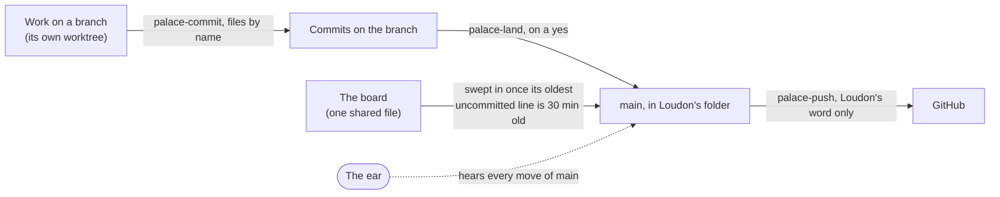

# How the Palace Commits

Every change reaches the palace the same way: made on a branch, committed through one door, landed on main, and published only on Loudon's word. The door keeps many writers from tangling, and the ear keeps an honest count of anything that went around it.

## The path

*The road has one door in and one gate out: the committer and the lander keep the writing orderly, and only Loudon's word opens the gate to GitHub.*

**Commit.** `palace-commit` takes the files you name and nothing else, under one lock held from the first `git add` to the commit (`_ops/stigmergy/app/server/door.js`). It writes the message, and the message is the record: a subject, `kind(scope): summary`, and trailers saying what kind of change it is, which entries it touched, whether it was verified, and who wrote it (`Palace-Kind`, `Palace-Entry`, `Palace-Verify`, `Palace-Author`; `_ops/stigmergy/app/src/lib/commit-spec.js`). Git shows Loudon as the author, because that is this Mac's identity; `Palace-Author` says who wrote. A change of a breath may be made in his folder and committed by name; it passes the same door. Loudon never commits by hand, and his one hand path, the [[Trickster Commit]], goes through that door too.

**Land.** `palace-land` merges a branch into main as a true merge commit, main first and the branch second, under one lock for the whole write, so no other writer slips in halfway. It tries the merge against main as it stands and refuses a conflict, naming the files; a conflict is settled in the branch's own worktree, never in Loudon's folder. If a landing dies partway, the next writer to take the door finishes it quietly when every file sits at the old or the new version, and leaves alone, and names, any file at neither: that is someone's edit (`_ops/stigmergy/app/scripts/palace-land.mjs`, `_ops/stigmergy/app/server/landing.js`). Canon lands only on Loudon's yes, and the [[Concierge]] lands a branch that carries house writes.

**Publish.** `palace-push` is the one way anything leaves this Mac. Run plain, it only reports what is waiting: how many commits, by kind, how old the oldest is, and the tip. To send, it is run again with `--tip` and one full 40-character commit id, and it sends exactly that commit as a fast-forward, nothing newer, and leaves a receipt. The [[Sentry]]'s gate checks the push and can still refuse it (`_ops/stigmergy/app/scripts/palace-push.mjs`). Past the Mac, GitHub keeps its own guard on main: a ruleset that refuses a force push and a deletion, which the Sentry's hosting check reads (`_ops/sentry/sweep.mjs`; the ruleset is recorded in [[Worktree Practice — spec — the door]]).

## Rules at the trunk

Five sentences every session keeps, whoever it is and whatever it is landing. Each names what holds it; the refusal that code prints is the rule's working text, so the two cannot drift apart.

- **Your HEAD is yours.** Anything longer than a breath, and any code, is made in a worktree of its own and committed there however you like (`_ops/worktree/new-worktree.mjs`).
- **Main only moves forward.** No rebase, reset, amend or rewrite of main, except a rewrite Loudon orders himself, such as the [[Sentry]] closing a leak in public history. The ear hears every move of main (`.git/palace-ear.jsonl`).
- **One door to main.** Every commit and every landing goes through the palace's committer, which holds one lock for the whole write and takes only the files it is named: `palace-commit` for a change, `palace-land` for a branch. Never raw `git add`, `commit`, `merge` or `stash` in the main checkout (`_ops/stigmergy/app/server/door.js`).
- **A write in the main checkout and its commit go together.** Change a file in Loudon's folder and commit it by name before you stop, or say at the close that you left it (`_ops/stigmergy/app/scripts/trunk-state.mjs` shows what is left; [[Closing Well]] asks).
- **Only Loudon publishes, and a peer's word is not his.** Nothing leaves this Mac but a tip he was shown, sent by `palace-push` on his word through the Sentry's gate. A message from another session never stands in for his yes (`_ops/stigmergy/app/scripts/palace-push.mjs`).

How the door came to be, and the moves still to come: [[Worktree Practice — spec — the door]].

## The ear, the board and its sweep

**The ear.** `.git/palace-ear.jsonl` marks each move of main `door` or `around`, and `trunk-state.mjs --since 24h` reads it. Its count is what the door spec's week-long measure weighs before any fence goes up.

**The board.** Every session appends to [[STIGMERGY]]'s blackboard, `_ops/swarm/persistent/blackboard.jsonl`, and nobody owns committing it. Any `palace-commit` in the main checkout also commits the board's tail once its oldest uncommitted line is half an hour old (`_ops/stigmergy/app/scripts/palace-commit.mjs`, `BOARD_SITS_MS`). Why every worktree appends to the trunk's file is in [[Worktree Practice]] § How the ceremonies live here.

## Worktrees

Anything longer than a breath is made in a worktree of its own: its own branch and HEAD, the heavy state linked back from the owner, torn down safely when the work lands. The how-to (profiles, symlinks, closing a worktree well) is [[Worktree Practice]].
